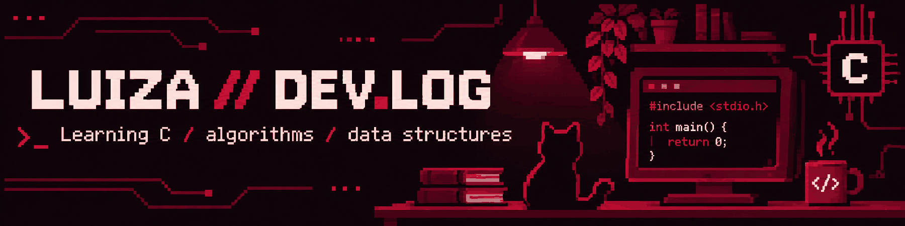

  

# Oi, eu sou a Luíza! ❤️

*Aprendendo programação, um algoritmo de cada vez.*

## `01 / sobre mim`

Estou começando a construir meu portfólio e estudando **programação em C**, **lógica**, **algoritmos** e **estruturas de dados**. Este perfil reúne exercícios e projetos para acompanhar minha evolução.

## `02 / estudando agora`

- **C:** funções, ponteiros, strings, alocação dinâmica e arquivos.
- **Algoritmos:** busca, ordenação, recursão e busca em largura (BFS).
- **Estruturas de dados:** listas encadeadas e filas.
- **Matrizes:** operações e alocação dinâmica.

## `03 / meus repositórios`

| Projeto | O que você encontra |
|:--|:--|
| [🎮 Jogos em C](https://github.com/luizacostc/jogos-em-c) | Adivinhe o Número e Pedra, Papel e Tesoura no terminal. |
| [📋 Cadastro de restaurantes](https://github.com/luizacostc/cadastro-restaurantes-em-c) | Lista encadeada e gravação/leitura de arquivo. |
| [⚙️ Algoritmos em C](https://github.com/luizacostc/algoritmos-em-c) | Busca, ordenação, grafos e recursão. |
| [🧩 Fundamentos em C](https://github.com/luizacostc/fundamentos-em-c) | Ponteiros, vetores, matrizes e memória dinâmica. |
| [📚 Lógica com Visualg](https://github.com/luizacostc/algoritmos-visualg) | Exercícios organizados por assunto. |

